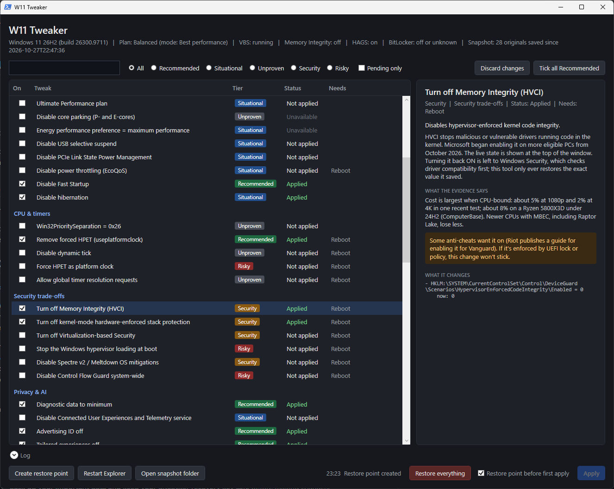

# W11 Tweaker

W11 Tweaker is a Windows 11 optimisation tool with a clean, easy-to-use interface. Turn tweaks on or off with a click; every original setting is saved first, so anything it changes can be put back.

Each tweak is labelled honestly by how much evidence there is behind it, from "Recommended" down to "Unproven", and the risky ones say exactly what they trade away.

## Features

- **71 tweaks** across gaming and graphics, power, CPU and timers, security trade-offs, privacy and AI, background apps and updates, input, network, storage, and desktop.
- **Evidence-based tiers.** Every tweak is tagged:
  - **Recommended** — measurable benefit or clear consensus, low downside.
  - **Situational** — helps in specific cases; read the trade-off.
  - **Unproven** — popular, but testing shows little or no effect on modern Windows. Included so you can try it yourself.
  - **Security** — gains performance by reducing protection (for example Memory Integrity / VBS).
  - **Risky** — can break things (for example stopping the hypervisor breaks WSL2 and Docker).
- **Snapshot and restore.** Before changing anything, the tool records the original value. Untick a tweak to put your original back, or press **Restore everything**.
- **Explains every tweak.** Each one shows what it does, what the evidence says, any warnings, the exact registry, power or boot setting it touches, its current value and your saved original.
- **Reads the real state.** For example, hardware-accelerated GPU scheduling is checked with the graphics driver, and the status strip shows whether VBS and Memory Integrity are actually running.
- **Applies instantly where possible.** Mouse, keyboard and accessibility tweaks take effect without signing out.
- **Quiet by design.** Routine changes apply with no pop-ups; you're only asked to confirm risky or one-way changes.

## Screenshot

*A Security tweak selected: the panel on the right explains what it does, what the evidence says, the trade-off, and the exact registry value it changes.*

## All tweaks

71 tweaks in total: 23 Recommended, 24 Situational, 17 Unproven, 4 Security, 3 Risky. Click a category to expand it.

<b>Gaming &amp; graphics</b> (9)

| Tweak | Tier | Needs | What it does |
|---|---|---|---|
| Game Mode | Recommended | - | Prioritises the focused game and stops Windows Update restarts and driver installs mid-session. |
| Hardware-accelerated GPU scheduling | Recommended | Reboot | Lets the GPU manage its own scheduling queue. Required for DLSS Frame Generation on RTX 40-series. |
| Optimizations for windowed games | Recommended | - | Upgrades DX10/11 borderless and windowed games to the flip presentation model. |
| Variable refresh rate for games (Windows VRR) | Situational | - | Lets older DX11 games without native VRR support use G-Sync/FreeSync. |
| Turn off Game Bar captures | Situational | - | Turns off Game Bar capture entirely, including "record what happened" background recording. |
| Stop the controller Xbox button opening Game Bar | Situational | - | Stops the Xbox/guide button on a controller popping up Game Bar. |
| Disable fullscreen optimizations globally | Unproven | - | Forces legacy exclusive fullscreen for DX9-11 games that request fullscreen. |
| Disable multiplane overlay (MPO) | Situational | Reboot | Workaround for flicker, black flashes or stutter with browsers, video or multi-monitor setups. |
| MMCSS "Games" scheduling category = High | Unproven | Reboot | Sets Scheduling Category High for the MMCSS Games profile. |

<b>Power</b> (10)

| Tweak | Tier | Needs | What it does |
|---|---|---|---|
| Balanced plan + "Best performance" power mode (Settings) | Recommended | - | Windows' intended desktop setup: Balanced plan with the Settings power mode on Best performance. |
| High performance plan | Situational | - | Keeps minimum processor state at 100% so cores don't drop to idle clocks. |
| Ultimate Performance plan | Situational | - | Unhides and activates the Ultimate Performance plan. |
| Disable core parking (P- and E-cores) | Unproven | - | Sets minimum unparked cores to 100% for both core classes on the active plan. |
| Energy performance preference = maximum performance | Situational | - | Tells the CPU's hardware boost (Speed Shift) to favour performance over efficiency. |
| Disable USB selective suspend | Situational | - | Stops Windows powering down idle USB devices. |
| Disable PCIe Link State Power Management | Situational | - | Keeps PCIe links (GPU, NVMe) out of low-power link states. |
| Disable power throttling (EcoQoS) | Situational | Reboot | Stops Windows pushing background apps onto E-cores at low clocks. |
| Disable Fast Startup | Recommended | - | Makes Shut down a real shutdown instead of a kernel hibernate. |
| Disable hibernation | Situational | - | Deletes hiberfil.sys and disables hibernate and Fast Startup. |

<b>CPU &amp; timers</b> (5)

| Tweak | Tier | Needs | What it does |
|---|---|---|---|
| Win32PrioritySeparation = 0x26 | Unproven | - | Short, variable scheduler quanta with a 3x foreground boost. |
| Remove forced HPET (useplatformclock) | Recommended | Reboot | Undoes an old tweak that forces HPET as the system timer. |
| Disable dynamic tick | Unproven | Reboot | Keeps the timer interrupt firing at a fixed rate even when idle. |
| Force HPET as platform clock | Risky | Reboot | Forces HPET instead of TSC as the timer source. |
| Allow global timer resolution requests | Unproven | Reboot | Restores the pre-Windows 10 2004 behaviour where one app's high timer resolution applies system-wide. |

<b>Security trade-offs</b> (6)

| Tweak | Tier | Needs | What it does |
|---|---|---|---|
| Turn off Memory Integrity (HVCI) | Security | Reboot | Disables hypervisor-enforced kernel code integrity. |
| Turn off kernel-mode hardware-enforced stack protection | Security | Reboot | Disables CET shadow stacks for kernel code (requires HVCI to be on in the first place). |
| Turn off Virtualization-based Security | Security | Reboot | Disables the isolated environment that HVCI, Credential Guard and others run in. |
| Stop the Windows hypervisor loading at boot | Risky | Reboot | Guarantees VBS can't run by not starting Hyper-V. |
| Disable Spectre v2 / Meltdown OS mitigations | Security | Reboot | Turns off Windows' software mitigations for CVE-2017-5715 and CVE-2017-5754. |
| Disable Control Flow Guard system-wide | Risky | Reboot | Turns off the CFG exploit mitigation for all processes. |

<b>Privacy &amp; AI</b> (15)

| Tweak | Tier | Needs | What it does |
|---|---|---|---|
| Diagnostic data to minimum | Recommended | - | Sets the telemetry policy to its lowest level. |
| Disable Connected User Experiences and Telemetry service | Situational | - | Stops the DiagTrack service that uploads diagnostic data. |
| Advertising ID off | Recommended | - | Stops apps using your advertising ID for personalised ads. |
| Tailored experiences off | Recommended | - | Stops Microsoft using diagnostic data for personalised tips and ads. |
| Activity history off | Recommended | - | Stops Windows collecting and uploading activity history. |
| Block Recall | Recommended | Reboot | Prevents Recall screen snapshots from being enabled. |
| Turn off Windows Copilot (legacy policy) | Unproven | - | Sets the old "Turn off Windows Copilot" policy. |
| Remove the Copilot app *(one-way)* | Situational | - | Uninstalls the Copilot app for your account. |
| Remove Bing web results from Start search | Recommended | Explorer | Start search only searches your PC. |
| Remove Start menu recommendations and account nags | Recommended | Explorer | Turns off "tips, shortcuts, new apps" recommendations and Microsoft account prompts in Start. |
| Stop suggestions, tips and silent app installs | Recommended | - | Disables Content Delivery Manager suggestions and promoted app installs. |
| Lock screen tips and fun facts off | Recommended | - | Removes the overlay tips and facts on the lock screen. |
| Disable Widgets | Recommended | Explorer | Removes the Widgets board and its background WebView processes (policy). |
| Remove Widgets (Web Experience Pack) *(one-way)* | Situational | Explorer | Uninstalls the app that powers Widgets. Use this if the Widgets policy is blocked on your PC. |
| Disable Windows Error Reporting | Situational | - | Stops crash reports being sent to Microsoft. |

<b>Background &amp; updates</b> (12)

| Tweak | Tier | Needs | What it does |
|---|---|---|---|
| Delivery Optimization: no peer-to-peer | Recommended | - | Downloads updates from Microsoft only and stops uploading them to other PCs. |
| Stop Windows Update installing drivers | Recommended | - | Stops Windows Update replacing your GPU or chipset drivers. |
| No automatic restart while signed in (legacy policy) | Unproven | - | Asks Windows Update not to restart the PC while you're signed in. |
| Block Store apps running in the background | Situational | - | Stops Microsoft Store apps running when not open. |
| Stop Edge running in the background | Situational | - | Disables Edge Startup Boost and background mode. |
| Disable SysMain (Superfetch) | Unproven | - | Stops Windows preloading frequently used apps into RAM. |
| Disable memory compression | Unproven | Reboot | Stops Windows compressing memory pages instead of paging them out. |
| Disable Windows Search indexing | Situational | - | Stops the search indexer service. |
| Disable Print Spooler | Situational | - | Only if you never print, including to "Microsoft Print to PDF". |
| Disable Xbox services | Unproven | - | Disables Xbox Live auth, game save, networking and accessory services. |
| Remove startup app delay | Situational | - | Startup apps launch immediately after sign-in instead of being staggered. |
| Remove preinstalled consumer apps *(one-way)* | Situational | - | Uninstalls News, Weather, Bing Search, Clipchamp, Solitaire, Microsoft 365 hub, To Do, Feedback Hub, Power Automate, Teams (personal) and new Outlook. |

<b>Input</b> (3)

| Tweak | Tier | Needs | What it does |
|---|---|---|---|
| Turn off "Enhance pointer precision" | Recommended | - | Removes Windows mouse acceleration. |
| Disable Sticky / Filter / Toggle Keys shortcuts | Recommended | - | Stops the pop-up when you tap Shift five times or hold Shift mid-game. |
| Shortest keyboard repeat delay | Situational | - | Held keys start repeating sooner. |

<b>Network</b> (3)

| Tweak | Tier | Needs | What it does |
|---|---|---|---|
| Disable NetworkThrottlingIndex | Unproven | Reboot | Removes the MMCSS cap on network packet processing while multimedia plays. |
| MMCSS SystemResponsiveness = 10 | Unproven | Reboot | Reserves 10% CPU for background tasks under MMCSS instead of the default 20%. |
| Disable TCP delayed ACK (often sold as "disable Nagle") | Unproven | - | Sets TcpAckFrequency=1 (and the legacy TCPNoDelay=1) on every connected IPv4 adapter. |

<b>Storage</b> (2)

| Tweak | Tier | Needs | What it does |
|---|---|---|---|
| Make sure TRIM is enabled | Recommended | - | Ensures Windows sends TRIM to SSDs. |
| Disable NTFS last-access timestamps | Unproven | Reboot | Stops NTFS updating the last-access time whenever a file is read. |

<b>Desktop &amp; UI</b> (6)

| Tweak | Tier | Needs | What it does |
|---|---|---|---|
| Turn off transparency effects | Unproven | - | Solid taskbar, Start and window backgrounds. |
| Turn off window and taskbar animations | Unproven | Sign out | Windows snap open and closed without the minimise/maximise animation. |
| Faster menus (MenuShowDelay 100 ms) | Situational | - | Cascading menus open after 100 ms instead of 400 ms. |
| Classic right-click menu | Situational | Explorer | Brings back the full Windows 10 context menu without "Show more options". |
| Add "End task" to taskbar right-click | Recommended | Explorer | Kill a frozen app straight from its taskbar icon. |
| Show file extensions | Recommended | Explorer | Shows .exe, .ps1, .pdf and so on in Explorer. |

*One-way* tweaks remove apps and can't be undone by Restore; reinstall them from the Microsoft Store. "Needs" shows whether a restart, sign-out or Explorer restart is required.

## Safety

- Offers a **Windows restore point** before the first change in a session.
- **Never turns security features on or off behind your back.** Reverting only restores the exact value it saved; it won't re-enable Memory Integrity without Windows Security's driver check.
- If a setting was already that way before you used the tool, reverting leaves it alone.
- **BitLocker aware.** Offers to suspend BitLocker for one restart before boot-time security changes, refuses to stop the hypervisor when VBS is set to Mandatory, and skips VBS changes that are UEFI-locked.
- Its data folder (`%ProgramData%\W11Tweaker`) is locked to Administrators and SYSTEM, and every saved value is validated before it's written back.
- Two tweaks (app removals) are one-way and clearly marked; reinstall those apps from the Microsoft Store.

Deliberately **not** included: turning off Defender, UAC, Smart App Control (can't be re-enabled without reinstalling Windows), disabling Windows Update, removing the page file, and GPU driver settings.

## Requirements

- Windows 11 (built and checked against 24H2/25H2)
- Windows PowerShell 5.1 (built in)
- An administrator account

## Usage

1. Download `W11Tweaker.ps1` and `Run W11 Tweaker.cmd` into the same folder.
2. Double-click **Run W11 Tweaker.cmd** and approve the admin prompt.
3. Tick or untick tweaks, then press **Apply**. The status line tells you if a restart, sign-out or Explorer restart is needed.

Logs and the snapshot live in `%ProgramData%\W11Tweaker`.

For best security, keep the tool in a folder only administrators can write to (for example `C:\Program Files\W11Tweaker`) rather than Downloads.

## Licence

Released under the [MIT Licence](LICENSE). You're free to use, modify and share W11 Tweaker, including in your own projects, as long as you keep the copyright notice. Contributions and forks are welcome.

## Disclaimer

**Use this tool entirely at your own risk.**

W11 Tweaker changes Windows system settings, including registry values, power plans, services, boot configuration and security features. Although it saves your original settings and offers a restore point, changes like these can have unintended effects depending on your hardware, drivers, Windows version, other software and existing configuration.

This software is provided **"as is", without warranty of any kind**, express or implied, including but not limited to warranties of merchantability, fitness for a particular purpose and non-infringement. The author and contributors **accept no responsibility or liability** for any damage, data loss, system instability, failure to boot, security compromise, loss of warranty, lost time or any other loss or harm, direct or indirect, arising from the use or misuse of this tool, even if advised of the possibility of such damage.

In particular:

- **Security and Risky tweaks reduce protection or can break features.** Read each warning, and only apply them if you understand and accept the trade-off.
- **The snapshot and restore features are a best effort, not a guarantee.** Some changes (such as removed apps) can't be undone automatically, and Windows updates, other tools or hardware changes can interfere with restoring.
- **Back up your important data and keep your BitLocker recovery key safe** before making changes.
- Nothing here is professional advice. Descriptions and evidence notes reflect publicly available information at the time of writing and may become outdated as Windows changes.
- This project is not affiliated with, endorsed by or supported by Microsoft. Windows is a trademark of Microsoft Corporation.

By downloading or running this tool, you accept full responsibility for its use and any consequences.
